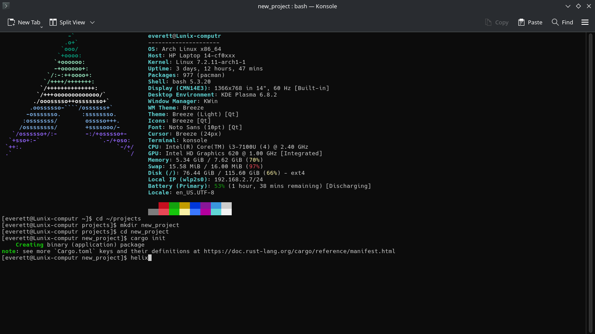

<h1>
  Structure
</h1>

  

 <!-- Alignment? -->
  This repo contains multiple .rs files. 
  Each of these files is named after a folder that they belong in 
  Each folder must be initialized using <code>$ cargo init</code> 
  Each of these uniquely named files must replace the main file  in the newly initialized folder.

<h1>
  FOR LINUX USERS ONLY!!! (If you have Windows, just use RustRover)
</h1>

  All further instructions are in photo at top of document
 

<h2>
  &emsp;&emsp;1. Location
</h2>
&emsp;Move to whatever folder contains all of your projects using <code>$ cd</code> 
&emsp;(Make a new folder with <code>mkdir</code> if you don't have one already)

<h2>
  &emsp;&emsp;2. Make project folder
</h2>
&emsp;Use <code>$ mkdir</code> to create a new folder based on the name of the repo file

<h2>
  &emsp;&emsp;3. creating the project
</h2>
&emsp;use command <code>$ cargo init</code> to create the development environment

<h2>
  &emsp;4. Refactoring [UNREFERENCED] <!-- Bonus Content: -->
</h2>
&emsp;rename file to main and replace main file in <code>/main/src</code>
